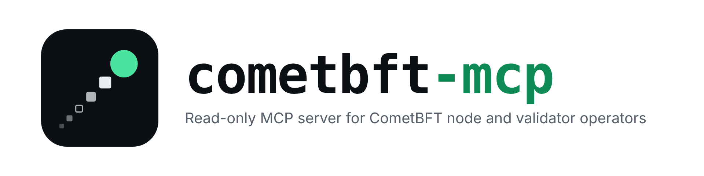
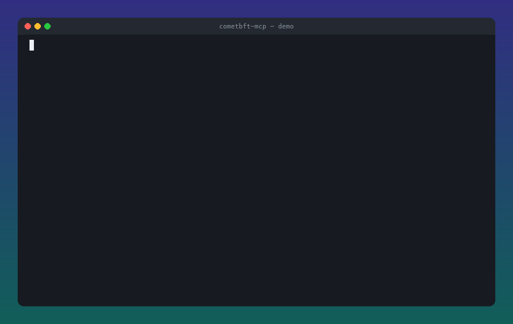

<p align="center">
  <picture>
    <source media="(prefers-color-scheme: dark)" srcset="docs/logo/logo-dark.png">
    
  </picture>
</p>

<p align="center">
  <a href="https://github.com/wookja-0/cometbft-mcp/actions/workflows/ci.yml"></a>
  <a href="https://github.com/wookja-0/cometbft-mcp/actions/workflows/e2e.yml"></a>
  <a href="https://github.com/wookja-0/cometbft-mcp/releases/latest"></a>
  <a href="go.mod"></a>
  <a href="https://registry.modelcontextprotocol.io/v0/servers?search=io.github.wookja-0/cometbft-mcp"></a>
  <a href="https://glama.ai/mcp/servers/wookja-0/cometbft-mcp"></a>
  <a href="https://github.com/wookja-0/cometbft-mcp/pkgs/container/cometbft-mcp"></a>
  <a href="LICENSE"></a>
</p>

<p align="center"><b>A read-only MCP server for CometBFT node and validator operators.</b></p>

Ask your agent *"Is my validator signing?"*, *"How close is it to jail?"*, *"Why did the chain stop?"* or *"Are we ready for the upgrade?"* and get an answer grounded in your own nodes and the chain's own slashing state — judged the way an operator would judge them, and unable to change anything.

Works with any CometBFT chain (Cosmos Hub, Osmosis, any Cosmos SDK chain, non-SDK CometBFT apps) and any MCP client (Claude Code, Claude Desktop, Cursor, VS Code, Codex, Gemini CLI, …).

> [!WARNING]
> Early release (v0.4). The tool API may still change.

<p align="center">
  
  <br>
  <sub>Real tool output against the bundled localnet — nodes are actually stopped; waits are compressed. <a href="docs/demo/demo.sh">Reproduce it</a>.</sub>
</p>

**Contents:** [What you can ask](#what-you-can-ask) · [Quick start](#quick-start-1-minute-public-rpc) · [Install](#install) · [Connect a client](#connect-a-client) · [Configuration](#configuration) · [Tools](#tools) · [Security model](#security-model) · [How it decides](#how-it-decides) · [Troubleshooting](#troubleshooting) · [FAQ](#faq) · [Development](#development)

## What you can ask

Real output from the bundled local network.

### Is my validator signing — and how far is it from jail?

> *"Is val3 signing? How long until it gets jailed?"*

```
val3 [critical]: signed 26/30 blocks (88–117), missed 4 (13.33%), 4 missed in a row at the head;
21 more misses until downtime jail (~37s at the current rate)
```

Read from commit signatures (works while the validator itself is down) and the chain's own `x/slashing` counter, with the jail threshold computed exactly as the SDK does.

### Why did blocks stop?

> *"The chain isn't producing blocks. Why?"*

```
height 115 round 0 (Prevote) for 60s [critical]: prevotes 50.1%, precommits 0.0% of power —
no_quorum; not voting: val3, val2
```

Tells *"not enough voting power online — and who is missing"* apart from *"validators online but not committing"* (an upgrade halt, an app hash error). The 50.1% is not a typo: `val2` had been slashed 1% for downtime earlier in the run.

### Are we ready for the upgrade?

> *"Is there an upgrade coming? Are all nodes on the same version?"*

```
localnet-1 [ok]: upgrade <untrusted>v2-e2e</untrusted> at height 10000000 in ~164d20h (9999969 blocks)
```

The `x/upgrade` plan with an ETA from the measured block time, upgrade proposals still in voting, and version skew across nodes. `<untrusted>` marks text that came from the chain — here a governance proposal — so the agent treats it as data.

### Is everything ok?

> *"Run a daily check"* — or use the `daily_check` prompt.

```
[critical] 5 nodes (4 ok, 1 critical), 4 validators (3 ok, 1 critical); localnet-1 [ok]: no upgrade scheduled — needs attention: val3
```

Also: *"Is val0 really behind its sentry?"* (`peer_health` flags validators with public-address peers), *"Is any node falling behind?"*, and `incident_triage` for an evidence-first diagnosis of one node.

## Quick start (1 minute, public RPC)

No access to your nodes needed: point it at a public RPC and watch any validator by its consensus address.

```bash
go install github.com/wookja-0/cometbft-mcp/cmd/cometbft-mcp@latest

cat > hub.yaml <<'EOF'
cosmos:
  rest: https://cosmos-rest.publicnode.com
nodes:
  - name: public
    role: full
    rpc: https://cosmos-rpc.publicnode.com:443
  - name: my-validator
    role: validator
    validator_address: cosmosvalcons1...   # yours, or any validator's
EOF

cometbft-mcp check --config hub.yaml
claude mcp add cometbft -- cometbft-mcp --config "$PWD/hub.yaml" --concurrency 8
```

Then ask: *"Is my-validator signing? How far is it from jail?"*

`validator_address` is the **consensus** address (`…valcons1…` or 40-char hex), not a wallet (`cosmos1…`) or operator (`cosmosvaloper1…`) address. Get it with `<appd> comet show-address` on the validator, from `/status` → `validator_info.address`, or from an explorer.

## Install

| Method | |
|---|---|
| **Binary** | Linux and macOS (amd64/arm64) from [Releases](https://github.com/wookja-0/cometbft-mcp/releases), with build-provenance attestations: `gh attestation verify <file> --repo wookja-0/cometbft-mcp` |
| **Go** | `go install github.com/wookja-0/cometbft-mcp/cmd/cometbft-mcp@latest` |
| **Container** | `ghcr.io/wookja-0/cometbft-mcp` — distroless, non-root; the only host access it needs is your config, mounted read-only |
| **MCP Registry** | listed as [`io.github.wookja-0/cometbft-mcp`](https://registry.modelcontextprotocol.io/v0/servers?search=io.github.wookja-0/cometbft-mcp) |
| **Glama** | [glama.ai/mcp/servers/wookja-0/cometbft-mcp](https://glama.ai/mcp/servers/wookja-0/cometbft-mcp) |

[](https://glama.ai/mcp/servers/wookja-0/cometbft-mcp)

## Connect a client

Use absolute paths: most clients do not expand `~`.

<details>
<summary><b>Claude Code</b></summary>

```bash
claude mcp add cometbft -- cometbft-mcp --config /Users/you/.config/cometbft-mcp/config.yaml
```
</details>

<details>
<summary><b>Claude Desktop</b></summary>

`~/Library/Application Support/Claude/claude_desktop_config.json` (macOS):

```json
{
  "mcpServers": {
    "cometbft": {
      "command": "cometbft-mcp",
      "args": ["--config", "/Users/you/.config/cometbft-mcp/config.yaml"]
    }
  }
}
```
</details>

<details>
<summary><b>Cursor</b></summary>

`~/.cursor/mcp.json`:

```json
{
  "mcpServers": {
    "cometbft": {
      "command": "cometbft-mcp",
      "args": ["--config", "/Users/you/.config/cometbft-mcp/config.yaml"]
    }
  }
}
```
</details>

<details>
<summary><b>VS Code</b></summary>

`.vscode/mcp.json`:

```json
{
  "servers": {
    "cometbft": {
      "type": "stdio",
      "command": "cometbft-mcp",
      "args": ["--config", "/Users/you/.config/cometbft-mcp/config.yaml"]
    }
  }
}
```
</details>

<details>
<summary><b>Codex CLI</b></summary>

`~/.codex/config.toml`:

```toml
[mcp_servers.cometbft]
command = "cometbft-mcp"
args = ["--config", "/Users/you/.config/cometbft-mcp/config.yaml"]
```
</details>

<details>
<summary><b>Gemini CLI</b></summary>

`~/.gemini/settings.json`:

```json
{
  "mcpServers": {
    "cometbft": {
      "command": "cometbft-mcp",
      "args": ["--config", "/Users/you/.config/cometbft-mcp/config.yaml"]
    }
  }
}
```
</details>

<details>
<summary><b>Docker (any client)</b></summary>

```json
{
  "mcpServers": {
    "cometbft": {
      "command": "docker",
      "args": ["run", "-i", "--rm",
               "--mount", "type=bind,src=/Users/you/.config/cometbft-mcp/config.yaml,dst=/config/config.yaml,readonly",
               "ghcr.io/wookja-0/cometbft-mcp:0.4.4"]
    }
  }
}
```

Or skip the mount and pass the config inline: `"-e", "COMETBFT_MCP_CONFIG_YAML={nodes: [...]}"` before the image name.

Inside a container `127.0.0.1` is the container itself: point the config at `host.docker.internal` (Docker Desktop) or add `--network host` (Linux) to reach SSH tunnels on the host.
</details>

## Configuration

Where the config comes from, first match wins:

1. `--config <path>`
2. `$COMETBFT_MCP_CONFIG_YAML` — the YAML itself, for places that take environment variables but not files (containers, hosted MCP runners). Flow style fits on one line:
   ```bash
   COMETBFT_MCP_CONFIG_YAML='{cosmos: {rest: "https://cosmos-rest.publicnode.com"}, nodes: [{name: public, role: full, rpc: "https://cosmos-rpc.publicnode.com:443"}]}'
   ```
3. `$COMETBFT_MCP_CONFIG` — a path
4. `~/.config/cometbft-mcp/config.yaml`

Start from the commented [`config.example.yaml`](config.example.yaml).

```yaml
# Optional: the Cosmos SDK layer (jail status, slashing margin, upgrades, monikers).
# Chain state is the same on every node: use a sentry's or full node's REST API.
cosmos:
  rest: http://127.0.0.1:1317

nodes:
  - name: sentry-1
    role: sentry                     # validator | sentry | full
    rpc: http://127.0.0.1:26657      # CometBFT RPC
  - name: val-1
    role: validator
    rpc: http://127.0.0.1:36657
    validator_address: cosmosvalcons1...   # keeps validator_health working while it is down
  - name: val-2
    role: validator                  # no rpc: watched by address only
    validator_address: cosmosvalcons1...
```

| Field | |
|---|---|
| `cosmos.rest` | Cosmos SDK REST (`app.toml` `[api]`, port 1317) of any synced node. Omit for non-SDK chains. |
| `nodes[].name` | Lowercase name the agent uses to refer to the node. |
| `nodes[].role` | `validator`, `sentry` or `full`. Commits are read from sentries and full nodes first, keeping load off validators. |
| `nodes[].rpc` | CometBFT RPC (port 26657). Optional for a validator that has `validator_address`. |
| `nodes[].validator_address` | Validators only: consensus address, hex or bech32 `…valcons1…`. |

There is deliberately no place for keys, mnemonics or tokens; fields that look like secrets are rejected.

**Reaching nodes.** Only port 26657 (and optionally 1317 on one node) is used. CometBFT binds RPC to `127.0.0.1` by default, so an SSH tunnel needs no node changes and no open ports: `ssh -N -L 36657:127.0.0.1:26657 val-1`. Do not open RPC to the internet for this.

| Flag | Default | |
|---|---|---|
| `--config` | see above | Path to the config |
| `--concurrency` | `4` | In-flight requests across all nodes. Gentle on your own nodes; `8` suits most public RPCs, less for rate-limited ones (HTTP 429). |
| `--timeout` | `10s` | Per-request timeout |
| `--reveal-network` | off | Show raw peer IPs, node IDs and transport errors to the model |

`cometbft-mcp check` prints a `node_status` report locally, without an MCP client, to verify a config.

Without a usable config the server still starts: its tools and prompts stay listed, and each call explains what to create, ending with a one-line public Cosmos Hub config to try first (it never echoes the config's contents, which may hold internal addresses). Fix the config and restart the MCP server.

## Tools

All tools are read-only (`readOnlyHint`). Every result has a `summary`, a `level` (`ok` / `warn` / `critical` / `unknown`) and `findings` with stable codes.

<details>
<summary><b><code>fleet_overview</code></b> — everything at once</summary>

One line per node with its issues, one summary per validator (last 50 blocks), the consensus round, and the upgrade status. The starting point for "is everything ok?".

No arguments.
</details>

<details>
<summary><b><code>node_status</code></b> — is each node synced?</summary>

Height, seconds since the last block, `catching_up`, blocks behind the highest node in the fleet, CometBFT and app versions; for validators the consensus address and voting power.

| Argument | |
|---|---|
| `node` | Node name; omit for every node |

Findings: `unreachable`, `catching_up`, `stale_head`, `behind_fleet`, `no_voting_power`, `address_mismatch`.
</details>

<details>
<summary><b><code>peer_health</code></b> — is each node well connected?</summary>

Peer count, inbound/outbound, peers on public addresses, peers on another chain, and a peer list (longest-lived first, at most 40) with addresses shown only as a class.

| Argument | |
|---|---|
| `node` | Node name; omit for every node |

Findings: `no_peers`, `few_peers`, `no_outbound_peers`, `not_listening`, `validator_public_peers` (a validator meant to sit behind sentries has public peers), `peers_on_other_chain`.
</details>

<details>
<summary><b><code>validator_health</code></b> — is the validator signing? how far from jail?</summary>

Signed / nil-vote / missed / not-in-set over the last N canonical blocks, consecutive misses at the head, last signed height, voting power, rank and share of the set, average block time. Blocks the node could not serve are counted as unreadable and make the result `unknown`. With `cosmos.rest`: jailed / tombstoned / bonding status, the chain's missed-block counter, `max_missed`, `misses_until_jail`, and `time_to_jail` when the validator is not signing right now. A validator outside the bonded set gets no jail margin, and on a chain without `x/slashing` (an ICS consumer) it is judged on liveness alone.

| Argument | |
|---|---|
| `node` | Validator name; optional when only one validator is configured |
| `window` | Blocks to scan, 10–500 (default 100) |

Findings: `not_signing`, `missed_blocks`, `left_active_set`, `not_in_active_set`, `partial_data`, `no_data`; with Cosmos: `jail_risk`, `jail_imminent`, `time_to_jail`, `jailed`, `tombstoned`, `not_bonded`, `jail_after_grace`, `no_signing_info`, `no_slashing_module`, `staking_unavailable` (status and moniker missing; the CometBFT set decides the margin), `cosmos_unavailable`.
</details>

<details>
<summary><b><code>consensus_diagnosis</code></b> — why did blocks stop?</summary>

The live round as one node sees it: height, round, step, time at this height, each validator's prevote and precommit in the current round (`block` / `nil` / `missing`), and whether more than 2/3 of voting power is voting. Validators are labeled by config name or staking moniker.

| Argument | |
|---|---|
| `node` | Node to read from; default a synced sentry or full node |

Findings: `no_quorum` (names who is not voting), `stuck_with_quorum`, `many_rounds`, `vote_set_mismatch`.
</details>

<details>
<summary><b><code>upgrade_readiness</code></b> — is an upgrade coming? <i>(needs <code>cosmos.rest</code>)</i></summary>

The `x/upgrade` plan (name, height, blocks remaining, ETA), software-upgrade proposals in their voting period, and each node's app and CometBFT version. Registered only when `cosmos.rest` is configured (or when the server has no config yet, so directories list every tool). It cannot see whether the new binary is staged on each host, and says so.

No arguments.

Findings: `upgrade_soon`, `upgrade_height_reached`, `upgrade_halt`, `version_skew`, `plan_unavailable`, `proposals_unavailable`, `no_gov_v1` (no governance module, as on authority-run chains: only the plan is checked).
</details>

**Prompts:** `daily_check` (sweep, drill into what is flagged, report as an operator briefing) and `incident_triage` (arguments `node`, optional `symptom`: evidence-first diagnosis ending with what to check on the host).

## Security model

Validator operators should not have to trust an LLM with their infrastructure, so this server is built so that it **cannot** do damage, rather than promising it won't:

- **No keys, ever.** No config field can point at `priv_validator_key.json`, a keyring or a mnemonic; secret-looking fields are rejected by name. Nothing reads the filesystem besides the config.
- **Read-only by construction.** One HTTP client issues only `GET`s to a hard-coded allowlist: CometBFT `/status`, `/net_info`, `/validators`, `/commit`, `/consensus_state`, `/abci_info`, `/health`, and Cosmos SDK slashing, staking, upgrade and gov queries. `broadcast_*`, `unsafe_*`, `dial_*`, `check_tx`, `/dump_consensus_state` (it lists peer addresses) and `/cosmos/tx/` are denied outright; path parameters are pattern-checked; redirects are never followed; responses are size-capped.
- **Network details are masked.** Peer IPs appear only as a class (`private-ipv4`, `public-ipv4`, …), node IDs are truncated, and errors never carry an address, so a sentry-protected validator's IP does not end up in an LLM provider's logs. `--reveal-network` turns this off, explicitly.
- **Node text is untrusted.** Everything a node or REST server controls — monikers, versions, error messages, upgrade plans — is wrapped in `<untrusted>` tags or must match its expected format, so a hostile peer or public RPC cannot inject instructions into your agent.
- **Gentle on nodes.** A global concurrency cap and bounded block scans; commits are read from sentries or full nodes first.
- **Supply chain.** Release archives and images carry build-provenance attestations; CI actions and base images are pinned by digest.

Threat model and reporting: [SECURITY.md](SECURITY.md).

## How it decides

**Liveness.** A CometBFT commit lists every validator in the set at that height, in voting-power order, but **absent signatures carry no address**. So the tool looks for the validator's address in each commit; when it is not there, it reads the validator set at that height and the signature at the validator's index: absent means *missed*, no index means *not in the set*. It scans canonical commits only, up to `latest − 1`: the commit a node returns for the newest height is its *seen commit*, holding only the precommits that arrived before +2/3, where a validator behind a sentry routinely looks absent. Canonical commits are also what downtime slashing counts.

**Jail risk.** With the Cosmos SDK layer it reads the chain's own inputs — `x/slashing` params and signing info, and `x/staking` matched by consensus key — and computes the threshold exactly as `x/slashing` does: `window − round_half_even(window × min_signed_per_window)`, including the grace period before `start_height + window`. A future `jailed_until` counts as jailed even if the staking lookup fails, because jailing resets the miss counter and would otherwise look like a clean record. `x/slashing` only counts the bonded set, so a validator outside it has no margin and no time to jail.

**Halts.** CometBFT needs more than 2/3 of voting power to prevote and precommit. `consensus_diagnosis` reads the current round's votes (CometBFT also lists the next round, still empty, which is skipped), checks each vote against the validator at its position, and sums the power that has voted.

## Compatibility

Tested on 2026-11-06 against 11 mainnets through public endpoints, read-only (`test/mainnet/`), and cross-checked against each chain's own state: the `x/slashing` miss counter and threshold, jailed / tombstoned / bonded status, consensus address and active-set rank.

| Chain | CometBFT | Cosmos SDK | Notes |
|---|---|---|---|
| Cosmos Hub | 0.38.25 | 0.53.8 | 180 active / 640+ staking validators |
| Osmosis | 0.38.22 | 0.50.14 | |
| Celestia | 0.38.17 | 0.52.12 | |
| dYdX | 0.38.5 | 0.50.6 | ~1 s blocks |
| Injective | 1.0.1 | 0.50.15 | |
| Neutron | 0.38.19 | 0.53.4 | |
| Akash | 0.38.19 | 0.53.7 | |
| Juno | 0.38.22 | 0.53.7 | |
| Kava | 0.37.16 | 0.47.15 | |
| Noble | 0.38.19 | 0.50.14 | No `x/gov` (authority-run): the upgrade plan is checked, proposals are not |
| Stride | 0.39.0 | 0.54.3 | ICS consumer, no `x/slashing`: judged on signing liveness alone |
| localnet (simd) | 0.39.4 | 0.54.4 | e2e: downtime, jail + unjail, upgrade, halt |

Versions are what the chains' `/status` and `node_info` reported. ed25519 consensus keys only. Not supported: Tendermint2 (gno.land).

**Speed and rate limits.** `validator_health` (100 blocks) takes ~5 s over a public RPC at `--concurrency 8`, ~10 s at the default 4. Some public endpoints (cosmos.directory, Polkachu) limit requests by volume: blocks they refuse count as unreadable and the result is `unknown`, never a guess. Lower `--concurrency` or use your own node.

## Troubleshooting

| Error code | Meaning | What to check |
|---|---|---|
| `rpc_unreachable` | Connection refused or DNS failure | URL and port, the SSH tunnel, firewall; the node process |
| `rpc_timeout` | No answer within `--timeout` | Node load, network latency; raise `--timeout` |
| `rpc_http_status` | Non-JSON HTTP error | A proxy or load balancer in front of the RPC; the URL path. `HTTP 429` is a public endpoint's rate limit: lower `--concurrency` |
| `rpc_bad_response` | Not a CometBFT JSON-RPC response | The URL points at something else (REST, gRPC-web, a web page) |
| `height_unavailable` | The node has pruned that height | Use a node with more history, or a smaller `window` |
| `rest_wrong_chain` | `cosmos.rest` is on another chain than the nodes | The REST URL |
| `no_slashing_module` / `no_gov_v1` (ok) | The chain does not have that module, e.g. an ICS consumer or an authority-run chain | Nothing: those checks do not apply there |
| `rest_not_found` / `no_signing_info` | The chain does not know the address | That `validator_address` is the **consensus** address, not `cosmos1…` / `cosmosvaloper1…` |
| `watched by validator_address only` | A node tool was called for a validator without `rpc` | Expected: only `validator_health` works for it |

## FAQ

**Can it unjail my validator, restart a node or send a transaction?** No, by design. There is no code path that signs or writes; see the [security model](#security-model).

**Does it need my validator's RPC?** No. A validator can be watched by `validator_address` alone; its signatures are read from your sentries, full nodes or a public RPC.

**What leaves my machine?** Tool results go to your MCP client and, through it, to the LLM provider: node names, roles, heights, peer counts, validator addresses. IPs and node IDs are masked. For production nodes, get your organization's approval first.

**Does it support gno.land?** Not yet: Tendermint2's RPC differs from CometBFT's. For gno.land itself see [gnoverse/gno-mcp](https://github.com/gnoverse/gno-mcp).

**Why no disk or memory checks?** On purpose: node_exporter and your existing alerting cover host metrics; cometbft-mcp focuses on judgments that need chain rules.

## Development

```bash
make test           # unit tests, no network
make lint
make localnet-up    # 4 validators + 1 sentry (simd) in Docker; writes localnet/config.yaml
make e2e            # MCP over stdio: downtime, a real jail + unjail, an upgrade proposal, a chain halt (~5 min)
go test -tags mainnet -v ./test/mainnet/   # read-only smoke test on 11 mainnets' public endpoints (~2 min)
```

The localnet's genesis is tuned so failures show up in seconds (50-block slashing window, 50% min signed, 60 s jail, 30 s voting). Try it interactively:

```bash
make build
claude mcp add cometbft-local -- "$PWD/bin/cometbft-mcp" --config "$PWD/localnet/config.yaml"
make localnet-stop VAL=val3           # "is val3 signing? how long until it's jailed?"
make localnet-stop VAL="val2 val3"    # halt the chain; wait a minute: "why did blocks stop?"
make localnet-down
```

CI runs lint and unit tests on every push and pull request (skipped when only docs change); the e2e suite runs daily, on demand, and on pull requests labeled `e2e`. Contributing: [CONTRIBUTING.md](CONTRIBUTING.md). The code map and the invariants that must never break: [AGENTS.md](AGENTS.md).

## Roadmap

- ICS consumer chains: read jail status from the provider chain
- secp256k1 consensus keys
- Tendermint2 (gno.land) adapter

## License

[Apache-2.0](LICENSE)
